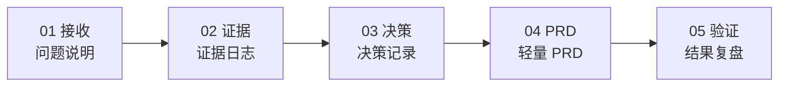

# PM Decision Flow

**把模糊需求变成可验证的产品决策。**

一套面向 B 端 SaaS 产品经理的五阶段工作流，从问题、证据和取舍出发，最终形成可执行的轻量 PRD。既可以手动使用，也可以作为 AI Agent 的 Skill 库。

English: A five-stage product management workflow for turning ambiguous requests into evidence, decisions, lightweight PRDs, and measurable follow-up.

Repository: [yh823456/pm-workflow](https://github.com/yh823456/pm-workflow)  
Public site: [yh823456.github.io/pm-workflow](https://yh823456.github.io/pm-workflow/) after the `main` branch deployment completes.

## 60 秒看懂

| 问题 | 这套工作流怎么处理 |
|---|---|
| 需求只有一句“客户想要 X” | 先拆成用户、场景、问题、影响和当前替代方案 |
| 团队把观点当成用户证据 | 每条信息标记为 `FACT`、`ASSUMPTION` 或 `SIMULATED` |
| 需求做了，但说不清为什么 | 用决策记录保存选项、取舍、风险和重新评估条件 |
| 进入研发后才发现范围不清 | 用轻量 PRD 明确范围、非目标、验收和指标 |
| 上线后只汇报“已发布” | 用结果复盘比较预期、实际和下一步决定 |



## 它解决什么问题

产品工作最常见的返工，不是文档太少，而是团队在尚未确认问题时就开始设计解决方案。

这套工作流把以下内容串成一条可以审计的链：

- 需求来自哪里，真实用户问题是什么？
- 哪些是事实、假设和模拟信息？
- 为什么做、为什么不做、为什么现在做？
- 最小可验证范围是什么，如何判断执行完成？
- 上线后是否产生预期变化，下一步继续、调整还是停止？

## 适合谁

| 适合 | 不适合 |
|---|---|
| 想系统练习产品判断的应届生和转型者 | 想寻找大规模产品管理 SaaS 平台的人 |
| 需要减少需求理解偏差的产品经理 | 希望 AI 自动替代用户研究和业务决策的团队 |
| 想把产品工作沉淀为 Skill 和模板的团队 | 只需要一份 PRD 填空模板的个人 |
| 希望公开作品集能展示完整思考链的求职者 | 期待真实客户数据、真实访谈和已验证业务收益的人 |

## 为什么不是又一个提示词模板库

- **有一套明确状态**：`workflow/state.json` 记录当前阶段、证据等级和下一动作。
- **有可审计日志**：`workflow/log.md` 保存证据、决策和变化。
- **区分证据质量**：模拟访谈不会被包装成真实用户研究。
- **手动也能用**：不依赖 Coze、Dify、API Key 或付费平台。
- **完整走通一次**：包含模拟案例、PRD、Axure 交付规范和结果计划。
- **控制复杂度**：只有五个阶段和五份主模板，不追求技能数量。

## 快速开始

### 1. 获取仓库

```bash
git clone https://github.com/yh823456/pm-workflow.git
cd pm-workflow
```

### 2. 选择一个当前需求

编辑 `workflow/state.json`：

```json
{
  "initiative": "Your current initiative",
  "stage": "intake",
  "owner": "Product Manager",
  "evidence_level": "public",
  "status": "in_progress",
  "gate": "Problem and impact are clear enough for evidence collection",
  "next_action": "Complete the problem brief",
  "updated_at": "2026-11-20"
}
```

### 3. 按阶段完成主产物

| 阶段 | 先读 | 再填写 |
|---|---|---|
| 01 接收 | [skills/01-intake.md](./skills/01-intake.md) | [templates/problem-brief.md](./templates/problem-brief.md) |
| 02 证据 | [skills/02-evidence.md](./skills/02-evidence.md) | [templates/evidence-log.md](./templates/evidence-log.md) |
| 03 决策 | [skills/03-decision.md](./skills/03-decision.md) | [templates/decision-record.md](./templates/decision-record.md) |
| 04 PRD | [skills/04-prd.md](./skills/04-prd.md) | [templates/lightweight-prd.md](./templates/lightweight-prd.md) |
| 05 验证 | [skills/05-verify.md](./skills/05-verify.md) | [templates/result-review.md](./templates/result-review.md) |

### 4. 运行验证

```bash
npm test
npm run docs:build
npm run docs:dev
```

本地预览默认地址：`http://127.0.0.1:4173/`

## 一次真实使用的产物链

```text
原始请求
  -> 问题说明：用户、场景、影响、证据缺口
  -> 证据日志：FACT / ASSUMPTION / SIMULATED
  -> 决策记录：至少三个选项与取舍
  -> 轻量 PRD：范围、非目标、验收、指标、风险
  -> 结果复盘：预期、实际、继续 / 调整 / 停止
```

旗舰模拟案例位于 [case-study/customer-feedback-platform](./case-study/customer-feedback-platform/)：

> 客户成功负责人提出“增加批量导出”。产品经理经过证据和决策记录，将需求修订为“带权限的筛选导出”，并把 PDF 排版和定时报告列为非目标。

这个案例展示的是判断过程，不代表真实市场需求。

## 五个阶段

| 阶段 | 回答的问题 | 主产物 | 通过条件 |
|---|---|---|---|
| 01 接收 | 谁在什么场景下遇到了什么问题？ | 问题说明 | 不是直接接受解决方案 |
| 02 证据 | 哪些是事实、假设和模拟信息？ | 证据日志 | 来源、限制和缺口已标注 |
| 03 决策 | 做、不做、延迟还是重新定义？ | 决策记录 | 取舍和替代方案清楚 |
| 04 PRD | 最小可执行范围是什么？ | 轻量 PRD | 设计研发可以执行 |
| 05 验证 | 上线后是否产生预期变化？ | 结果复盘 | 有继续、调整或停止结论 |

## 当前证据状态

> **Simulated case only.** The company, users, interviews, quotes, and data are fictional. This case is **NOT EXTERNALLY VALIDATED** and does not claim real market demand or business impact.

- 公开资料：仅用于一般 B 端治理模式的背景判断。
- 模拟访谈：明确标记为 `SIMULATED`，只用于练习和暴露未知问题。
- 业务收益：没有实际观测结果，不虚构 ROI、收入或客户反馈。
- 下一步：用真实且知情同意的参与者替换模拟访谈，再开展实际试点。

## 仓库导航

```text
skills/       五个阶段的可执行 Skill
templates/    五份可直接复制的主模板
workflow/     当前状态与决策日志
case-study/   从模糊请求到轻量 PRD 的完整模拟案例
prototype/    Axure 原型交付规范
website/      零依赖公开文档站
tests/        内容契约与站点构建测试
.github/      GitHub Pages 自动部署
```

## 设计与验证原则

- 每个阶段只有一个主产物和一个通过条件。
- 证据不足时可以继续澄清，但不能伪造结论。
- 小需求走快速路径，高风险需求才增加研究深度。
- 所有公开结论都必须与证据等级一致。
- `npm test` 检查工作流内容、状态字段和案例声明。
- `npm run docs:build` 生成可部署的静态站点。

## 发布状态

- 版本：`v0.1.0`
- 状态：可用的实践版，不是成熟商业产品
- 网站：零依赖静态 HTML/CSS
- 自动部署：GitHub Actions 发布到 GitHub Pages
- 下一阶段：真实访谈、完整 Axure 原型、3 个真实需求的试点记录

## 使用边界

这套工作流帮助团队减少“没想清楚就开始做”的返工，但不能替代真实用户研究、技术评估、法务审核或管理层业务决策。

## License

MIT
